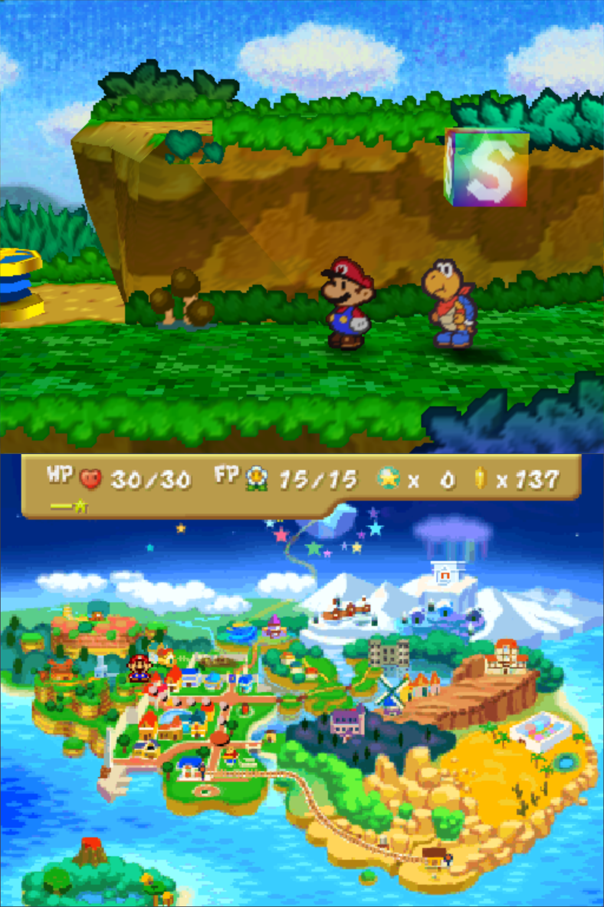
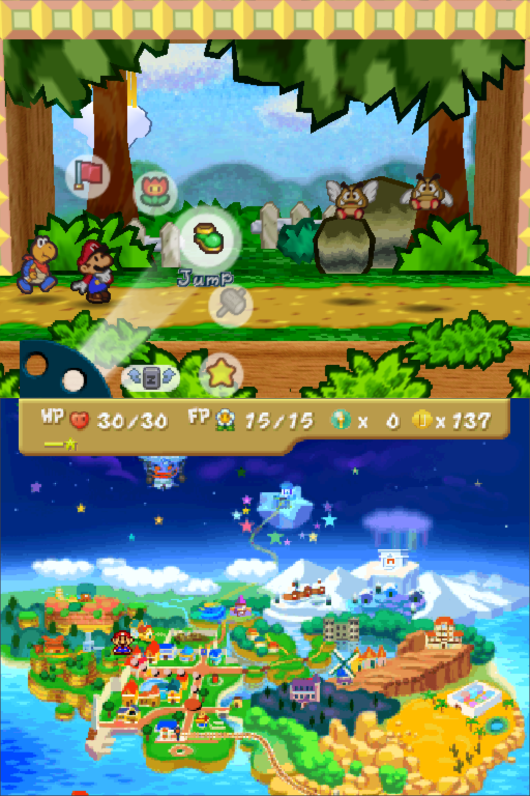
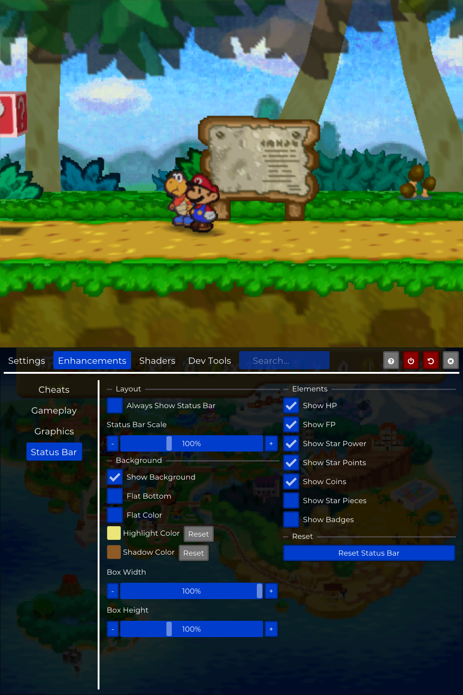

# PaperBoat for bananaOS: Paper Mario 64 on both screens of the Anbernic RG DS

A fork of [HarbourMasters/PaperBoat](https://github.com/HarbourMasters/PaperBoat) (Paper Mario 64 native port) for **bananaOS** on the
dual-screen **Anbernic RG DS Plus**. The game runs on one panel. The other panel shows the game's own status bar (HP, FP, coins, star
points) with the **world map** underneath. The map is drawn by the game itself, centred on Mario's current location, and you can
**drag it with the touch screen**. PaperBoat's ImGui menu opens on the bottom panel with working touch.

| Map and status bar | In a battle | Menu on the touch screen |
|---|---|---|
|  |  |  |

## Install

1. Download `Paperboat-bananaos-v1.0.0.zip` from the [latest release](../../../releases/latest).
2. Unzip it at the **root of the data partition** (the card that holds `roms/`), so that `roms/ports/Paperboat.sh` and
   `roms/ports/paperboat/` end up next to your other ports.
3. **Make `pm64.o2r` from your own ROM** (no game files are included). On a PC, run the official
   [PaperBoat release](https://github.com/HarbourMasters/PaperBoat/releases) with your Paper Mario (USA) `.z64`
   (SHA-1 `3837F44CDA784B466C9A2D99DF70D77C322B97A0`, big-endian). It writes `pm64.o2r`. Copy that file to `roms/ports/paperboat/`.
   (Extracting on the handheld can get the process killed for using too much memory.)
4. Start **Paperboat** from the ports list.

`Paperboat.sh` takes `PAPERBOAT_SCREENS`: `dual` (default: game on top, map and status bar below), `swap` (game on the bottom panel,
map and status bar on top) or `single` (stock single panel).

## Controls

The pad mapping is in `paperboat/banana-pad.txt`. The pad has one stick, so the C-buttons are on **X, Y, R1** and the **stick click**.
**Select** opens PaperBoat's menu, which is controllable with the D-pad (A in, B out) or the touch screen.

## What is in this branch

| Path | What |
|---|---|
| `src/inventory.c`, `src/pause/pause_map.c` | In dual mode the status bar and world map are rendered by the game into their own framebuffer |
| `src/port/ui/SecondScreen.cpp`, `Menu.cpp`, `PaperboatGui.cpp` | Shows that framebuffer and the menu on the second panel |
| `bananaos/patches/libultraship-bananaos.patch` | libultraship changes (panel layout, touch into ImGui, framebuffer texture, screenshot hook) |
| `bananaos/scripts/apply.sh` | Applies the libultraship patch to the submodule |
| `bananaos/scripts/build-in-chroot.sh` | Cross-build (aarch64, clang + lld) in a Debian trixie chroot |
| `bananaos/package/` | Launcher, pad mapping and config that go into the release zip |

Based on PaperBoat 1.0.3 (`7f038b8`) and [JeodC's libultraship](https://github.com/JeodC/libultraship) (`lus-converge`), and on Jeod's
Linux SBC build for the launcher setup and bundled libraries. Two panels use bananaOS's Banana-SDL "stack" mode: the SDL `offscreen` driver
with `SDL_BANANA_PANELS=stack` and one 1024x1536 window (top half = top panel).

## Build

1. `git clone --recursive -b bananaos-linux https://github.com/GASQBDUV/PaperBoat && cd PaperBoat && sh bananaos/scripts/apply.sh`
2. In an aarch64 cross environment (Debian trixie chroot with clang, lld, SDL2, libzip, spdlog, fmt, tinyxml2, ...), run
   `bananaos/scripts/build-in-chroot.sh`. The binary ends up in `/out-pb/Paperboat`. Put it in `roms/ports/paperboat/`.

## Debugging

`touch /run/banana/paperboat-shot` on the device saves both panels as `/data/screenshots/paperboat-panels-NNN.ppm` (this is how the
pictures above were taken). `/data/paperboat/maptest` (a number 0-3) is a leftover map debug switch and can be ignored.

## Status and limits

Tested on bananaOS 0.5.0.1, Anbernic RG DS Plus, Paper Mario (USA). The world map is shown, not an in-room map. Battles and the pause menu
still run on the game panel. Not tested: other devices, other ROM versions, `swap` for long sessions.

Paper Mario is a Nintendo game. This repository contains no game data. See the licenses in `bananaos/package/paperboat/licenses/` and the
upstream repository for the PaperBoat license.
